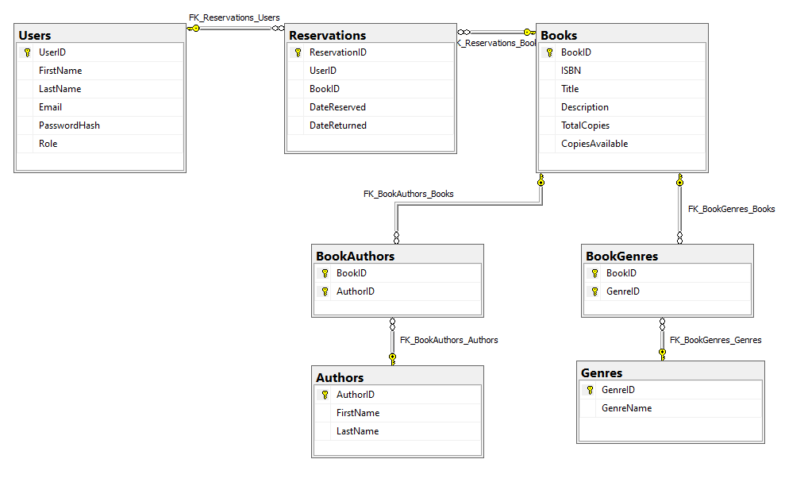

# Pocket Librarian database design

This document records the database design shown in `pocket_librarian.client/Documentation/Pocket_Librarian_Database.png`.

## Tables

| Table | Columns shown in the diagram | Purpose |
| --- | --- | --- |
| `Users` | `UserID` (PK), `FirstName`, `LastName`, `Email`, `PasswordHash`, `Role` | Stores member and staff accounts. |
| `Reservations` | `ReservationID` (PK), `UserID` (FK), `BookID` (FK), `DateReserved`, `DateReturned` | Stores the reservation history and connects members to books. |
| `Books` | `BookID` (PK), `ISBN`, `Title`, `Description`, `TotalCopies`, `CopiesAvailable` | Stores catalogue records and current copy availability. |
| `Authors` | `AuthorID` (PK), `FirstName`, `LastName` | Stores author records. |
| `BookAuthors` | `BookID` (PK/FK), `AuthorID` (PK/FK) | Junction table for the many-to-many book/author relationship. |
| `Genres` | `GenreID` (PK), `GenreName` | Stores genre records. |
| `BookGenres` | `BookID` (PK/FK), `GenreID` (PK/FK) | Junction table for the many-to-many book/genre relationship. |

## Relationships

- One `Users` row can have many `Reservations`; each reservation belongs to one user.
- One `Books` row can have many `Reservations`; each reservation belongs to one book.
- `Books` and `Authors` have a many-to-many relationship through `BookAuthors`.
- `Books` and `Genres` have a many-to-many relationship through `BookGenres`.
- The primary keys in the junction tables are composite keys made from their two foreign-key columns.

## Application architecture notes

The React frontend must call the ASP.NET Core API. It must not connect directly to SQL Server. The API's business-logic layer calls the data-access repository, and the repository performs the SQL query.

The current pipeline health check queries `dbo.Books` and returns a separate database status. If the database is unavailable, the API still returns a safe health-check response so the frontend can show the database as unavailable without crashing.

The database connection configuration in Jack's supplied branch targets a local SQL Server Express instance named `LEMON-DESKTOP\SQLEXPRESS` and database `Pocket-Librarian-DB`. The connection-status dashboard intentionally masks this target when it displays connection details.
