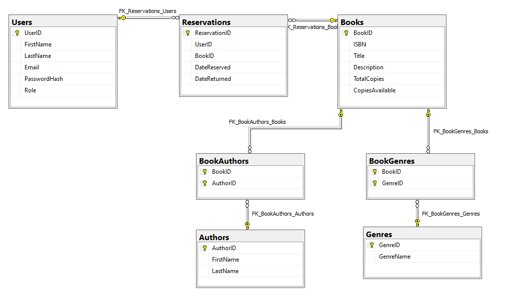

# Pocket Librarian database design

This document records the database design shown in `Client/Documentation/Pocket_Librarian_Database.png`.

## Tables

| Table | Columns shown in the diagram | Purpose |
| --- | --- | --- |
| `Users` | `UserID` (PK), `FirstName`, `LastName`, `Email`, `PasswordHash`, `Role` | Stores member and staff accounts. |
| `Reservations` | `ReservationID` (PK), `UserID` (FK), `BookID` (FK), `DateReserved`, `DateReturned` | Stores the reservation history and connects members to books. |
| `Notifications` | `NotificationID` (PK), `UserID` (FK), `Title`, `MessageText`, `CreatedDate`, `IsRead` | Stores member notifications and read status. |
| `Books` | `BookID` (PK), `ISBN`, `Title`, `Description`, `PublicationYear`, `ConditionSummary`, `CoverImagePath`, `SourceType`, `TotalCopies`, `CopiesAvailable` | Stores catalogue records and aggregate availability. |
| `BookDonations` | Donation metadata, `VerificationStatus`, `ReviewNotes`, `ApprovedBookID`, `CoverImagePath` | Stores member submissions and the staff review history. |
| `Authors` | `AuthorID` (PK), `FirstName`, `LastName` | Stores author records. |
| `BookAuthors` | `BookID` (PK/FK), `AuthorID` (PK/FK) | Junction table for the many-to-many book/author relationship. |
| `Genres` | `GenreID` (PK), `GenreName` | Stores genre records. |
| `BookGenres` | `BookID` (PK/FK), `GenreID` (PK/FK) | Junction table for the many-to-many book/genre relationship. |

## Relationships

- One Users row can submit many BookDonations; each donation is initially
  Pending Verification.
- An approved donation either creates a new Books row or increases the
  existing book's TotalCopies and CopiesAvailable values.

- One `Users` row can have many `Reservations`; each reservation belongs to one user.
- One `Users` row can have many `Notifications`; each notification belongs to one user.
- One `Books` row can have many `Reservations`; each reservation belongs to one book.
- `Books` and `Authors` have a many-to-many relationship through `BookAuthors`.
- `Books` and `Genres` have a many-to-many relationship through `BookGenres`.
- The primary keys in the junction tables are composite keys made from their two foreign-key columns.

## Book donations

Run the current Pocket Librarian database setup script after the core database
exists. The application does not modify the catalogue when a member submits a
request. Staff approval performs the donation-to-catalogue change in one
database transaction.

Inventory is intentionally tracked at the catalogue-title level:
`Books.TotalCopies` stores the number of copies owned and
`Books.CopiesAvailable` stores the number currently available. Individual
barcodes, shelf locations, and physical-copy statuses are outside the current
project scope.
Cover images are stored as files under `Server/wwwroot/uploads/covers`; SQL
stores the relative URL in `Books.CoverImagePath` or
`BookDonations.CoverImagePath`.

## Application architecture notes

The React frontend must call the ASP.NET Core API. It must not connect directly to SQL Server. The API's business-logic layer calls the data-access repository, and the repository performs the SQL query.

The local backend exposes two separate checks. `GET /api/health` confirms that ASP.NET Core is responding without calling the business or data-access layers. `GET /api/pipeline/database-status` queries `dbo.Books` and returns the database status. The full `GET /api/pipeline/test` endpoint remains the three-layer pipeline demonstration. If the database is unavailable, the backend-only health check still reports Online and the frontend can show the database as unavailable without crashing. Database connection and command probes use a short three-second timeout.

The backend always runs locally through ASP.NET Core. The database connection may target local SQL Server or Azure SQL. The repository reads `ConnectionStrings:PocketLibrarianDatabase`; an environment variable named `ConnectionStrings__PocketLibrarianDatabase` can override the local development value without changing source code. The connection-status dashboard intentionally masks the server and database names when it displays connection details.

The dashboard also includes a demo-only manual connection form. It sends a supplied connection string to the local API over the running HTTPS connection, tests `dbo.Books`, and keeps a successful manual target in server memory for the current process only. It is not written to source code, browser storage, or the repository. The user must supply the full connection information required by the chosen local or Azure SQL authentication method.

Member notifications are created lazily the first time an authenticated notification request is made. The API creates `dbo.Notifications` with a foreign key to `dbo.Users(UserID)` when the table does not already exist; it does not require the backend to connect to SQL Server during application startup.
